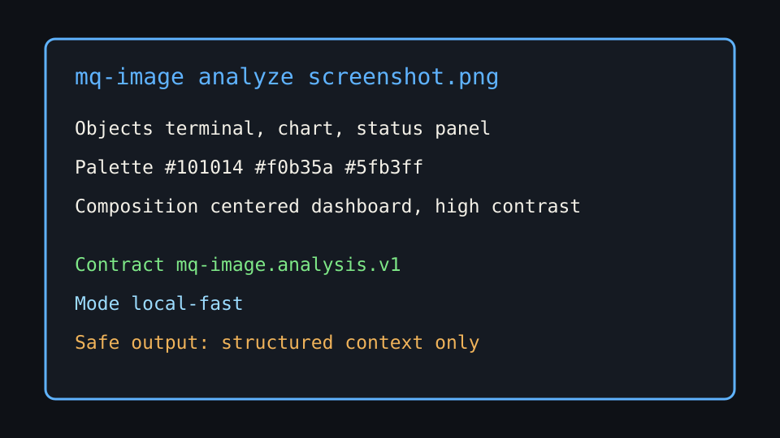

# mq-image-analyze

Visual reasoning infrastructure for image analysis.

**v1.9.0** — Object detection · Palette extraction · Composition analysis · Content flags · Semantic captions · UI analysis · Image comparison · Architecture observation · OCR · Perception records · Screenshot regression · MCP tools



---

## Quick start

```bash
pip install -e ".[web,mcp]"
mq-image analyze image.png
mq-image analyze-ui screenshot.png
mq-image compare before.png after.png
mq-image serve --port 8000
mq-image mcp
```

---

## Commands

| Command | Description |
|---|---|
| `analyze` | Full image analysis — objects, palette, composition, content flags, reverse prompt |
| `analyze-ui` | UI screenshot analysis — layout, WCAG contrast, hierarchy, accessibility |
| `compare` | Compare two images — palette drift, style drift, AI-look score |
| `observe-architecture` | Architecture diagram → `visual_architecture_observation.v1` JSON |
| `ocr` | Extract visible text from an image |
| `perceive` | Run one producer and print a normalized `perception.v1` record |
| `regress` | Compare a directory of screenshots against a baseline; exit 1 on change |
| `serve` | Web UI on localhost |
| `mcp` | Start MCP server for agent tool use |
| `doctor` | Check model and dependency health |

---

## MCP tools

| Tool | Description |
|---|---|
| `analyze_image` | Full visual reasoning |
| `extract_palette` | Colors, brightness, contrast |
| `reverse_prompt` | Prompt for image generators |
| `compare_images` | Visual drift detection |
| `analyze_ui` | Screenshot accessibility review |
| `observe_architecture` | Diagram structure as `visual_architecture_observation.v1` |
| `image_ocr` | Visible text as `image_ocr.v1` |
| `image_perception` | Normalized `perception.v1` record from the `ui`, `architecture` or `ocr` producer |

All tools are read-only. `analyze_image`, `reverse_prompt` and `compare_images` are safety Class B (OpenAI only with explicit `cloud-verify`); the rest are Class A. See [Tool safety](tool-safety.md).

---

## Docs

- [Architecture](architecture.md)
- [CLI reference](cli.md)
- [MCP tools](mcp-tools.md)
- [JSON schema](json-schema.md)
- [Content policy](content-policy.md)
- [Tool safety](tool-safety.md)
- [Model setup](model-setup.md)
- [Integration](integration.md)

---

## Design principles

- **No Silent Omission** — all detector output is preserved, no suppression
- **Neutral Explicit Content** — content_flags reported as-is, never filtered
- **Limitations always present** — every response includes what the models cannot see
- **Orchestration + Intelligence** — models are replaceable dependencies, not stored artifacts
